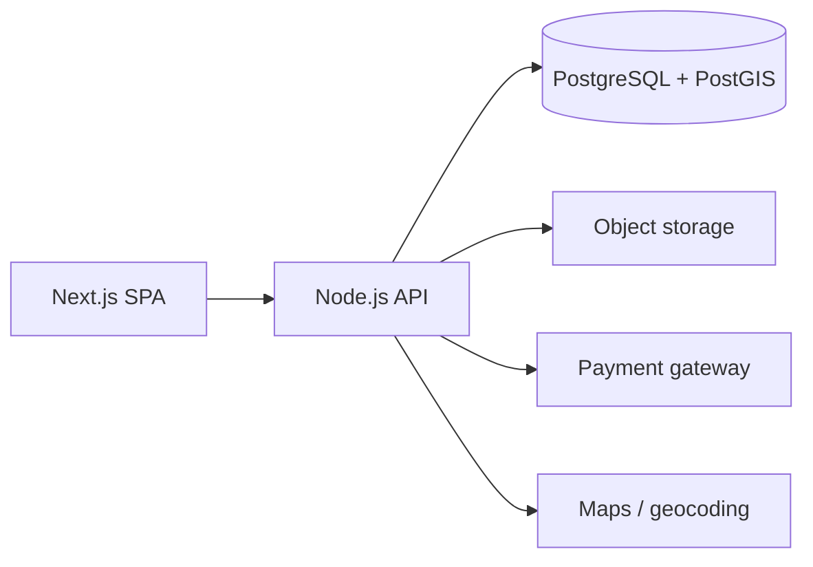

<h1 align="center">SymbioTrade</h1>

  <strong>A B2B marketplace that turns one company's industrial by-product into another company's raw material.</strong>

  
  
  

> **Status:** this repository contains the product and system specification
> only. There is no application code yet. The documents describe the intended
> MVP, architecture, UX flow, and delivery plan.

## The problem

Industrial waste is often a usable input for another industry, but the two
sides rarely find each other. Sellers pay disposal costs; buyers buy virgin
material; both miss the logistics and carbon benefits of a local exchange.

SymbioTrade is a B2B marketplace where a factory can list a by-product —
scrap metal, paper, organic residue, or a production offcut — and a nearby
processor can buy it as feedstock. Location-aware matching keeps transport
cost and emissions down.

## Who it serves

- **Sellers** — factories and producers with surplus or by-product streams.
- **Buyers** — processors and manufacturers looking for secondary feedstock.
- **Operators** — the platform team reviewing KYC documents, listings, and
  transactions.

## MVP scope

- Company registration and KYC document upload.
- Company profiles with factory coordinates.
- Waste listings with photos, category, volume, price, and availability.
- Search and location-aware matching.
- Order and transaction flow with a payment gateway.
- Seller and buyer dashboards.
- Admin verification and moderation.

## Specification

| Document | What it covers |
| --- | --- |
| [1. PRD](docs/symbiotrade/1_PRD.md) | Vision, problem, users, scope, and success metrics. |
| [2. SRD](docs/symbiotrade/2_SRD.md) | Functional and non-functional requirements for the MVP. |
| [3. SDD](docs/symbiotrade/3_SDD.md) | Architecture, data model, integrations, and tech-stack choices. |
| [4. UI/UX Flow](docs/symbiotrade/4_UI_UX_Flow.md) | Design direction and the seller, buyer, and admin journeys. |
| [5. Task Breakdown](docs/symbiotrade/5_Task_Breakdown.md) | Sprint-by-sprint delivery plan. |

## Intended architecture

The SDD recommends a modular monolith for the MVP: Next.js on the frontend,
Node.js with NestJS or Express on the backend, PostgreSQL with PostGIS for
location matching, Prisma or TypeORM, and S3-compatible storage for KYC and
listing photos.

## Roadmap

1. Validate the matching model with a small set of sellers and buyers.
2. Build authentication, company profiles, and KYC.
3. Ship listings, search, and location-aware matching.
4. Add orders, payments, and transaction states.
5. Add admin moderation and impact reporting (waste diverted, estimated CO₂
   avoided).

## Why this is public

The specification is published as a reference for teams building circular-economy
marketplaces. It is intentionally separate from the author's production
projects until the implementation exists.
